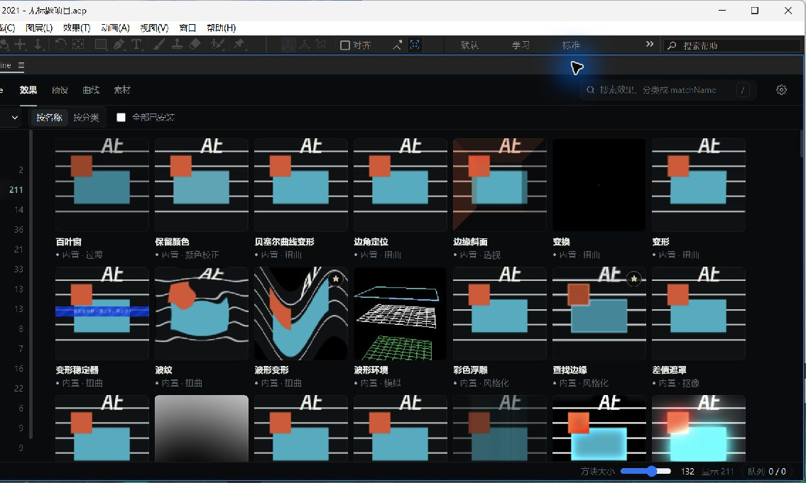
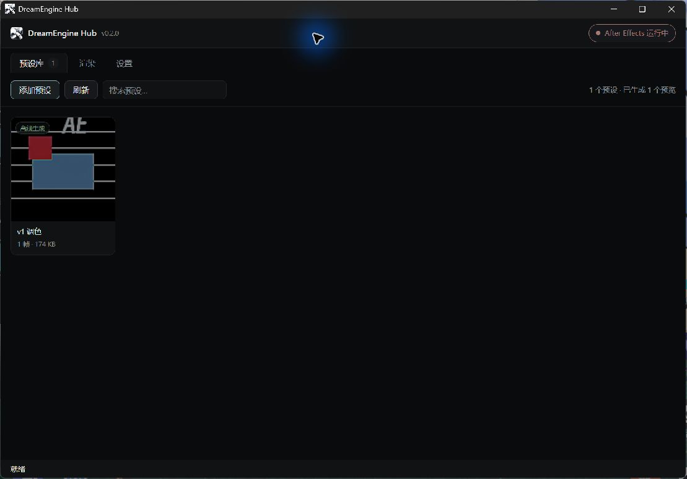

<h1 align="center">DreamEngine</h1>

<p align="center">
  After Effects 效果、预设、曲线和素材的一体化工作面板
</p>

<p align="center">
  <a href="README.en.md">English</a> · 中文
</p>

> **Beta 状态**：DreamEngine 目前面向 Windows，核心流程已在 After Effects 2021 / CEP 11 上实机验证。后续 AE 版本尚未完成全面验收。

## 下载 Beta

当前 Beta：**DreamEngine Hub 0.1.0 / 面板 0.2.0**

- [下载 Windows 安装包](https://github.com/yoanx/DreamEngine/releases/tag/v0.1.0-beta.1)
- 安装包未签名，Windows SmartScreen 可能显示“未知发布者”。
- 安装和升级只替换程序文件，不覆盖用户已经生成的预览和预设库。

## 三步开始

1. 保存工程并关闭 After Effects。
2. 运行 `DreamEngine-Hub-Setup-0.1.0.exe`，按提示完成安装。
3. 启动 AE，打开 `窗口 > 扩展 > DreamEngine`。

安装后可以直接使用面板。DreamEngine Hub 主要用于添加预设、生成预览和管理目录。

## 最常用操作

- **效果**：双击卡片，把效果加到当前选中的图层。
- **预设**：单击卡片直接应用；新增 `.ffx` 预设请打开 DreamEngine Hub。
- **素材**：单击播放预览；双击把素材加到当前合成的当前时间位置。
- **收藏**：鼠标移到卡片上，点右上角星标；收藏可与分类同时筛选。

## 实机截图

**After Effects 面板**



**DreamEngine Hub**



## 功能

### 效果面板

- 浏览、搜索和按插件来源筛选 After Effects 效果。
- 动态效果悬停播放预览，静态效果保持静止。
- 双击或点击 `+` 把效果添加到当前选中图层。
- 收藏效果，并与当前分类组合筛选。

### 预设库

- 通过 DreamEngine Hub 添加 `.ffx` 预设，支持文件选择和拖入。
- 浏览静态、动态和第三方插件预设预览。
- 在面板中创建自定义分类、重命名、删除和移动预设。
- 收藏预设；收藏是独立筛选，可与分类同时生效。

### 曲线编辑器

- 采用类似 Flow 的曲线模板工作流。
- 支持值、速度和空间路径图。
- 拖动把手调整曲线，应用时写入选中属性的关键帧缓动。
- 保存、删除和管理自定义曲线预设。

### 素材库

- 登记一个素材根目录，不复制、移动或修改源文件。
- 自动分类视频、图片、音频和 `.aep` 工程。
- 单击选中并播放预览：视频最多播放 2 秒，音频可点击播放或停止。
- 双击视频、图片或音频时导入项目，并添加到当前合成的当前时间指示器位置。
- `.aep` 只导入项目，不直接打开或添加为图层。
- 收藏素材，并与素材分类组合筛选。

## 环境要求

- Windows 10 / 11
- Adobe After Effects 2021 或更高版本
- 推荐安装 `ffmpeg`，用于音频波形和部分不兼容视频格式的预览缓存

首次安装会把 CEP 面板和内置预览库部署到用户目录，不需要管理员权限。对于未签名安装器，确认文件来源后再继续。

## 使用提示

- 效果卡双击添加到 AE 当前选中的图层。
- 预设卡单击应用；新增预设请使用 DreamEngine Hub。
- 素材双击会按当前合成时间添加图层；如果 AE 没有打开的合成，素材只会导入项目。
- 第三方插件预设的离线预览需要关闭 AE 后由 Hub 的专用渲染流程完成，不能在宿主 AE 中直接批量渲染。

## 用户数据

DreamEngine 不向网络上传素材、工程或预设。

- 预设库、缓存和背景图：`文档/DreamEngine/`
- 收藏和用户预设分类：CEP 面板的本地 `localStorage`
- 运行日志和探针数据：`文档/DreamEngineProbe/`

## 仓库内容

```text
cep/com.dreamengine.panel/   CEP 面板
hub/                         Electron 管理程序
dist/L1/                     内置效果预览包
```

开发探针、内部测试工具和进度笔记不包含在公开仓库中。安装和发布产物通过 GitHub Releases 提供。

## Beta 已知限制

- 安装包暂未签名。
- 仅在 After Effects 2021 / CEP 11 上完成完整实机验收。
- 第三方插件预览依赖用户本机插件环境，不能跨机器保证一致。
- 素材库目前只支持一个根目录，需要手动刷新磁盘变化。
- `.aep` 暂不解析工程内容，也不会自动打开。
